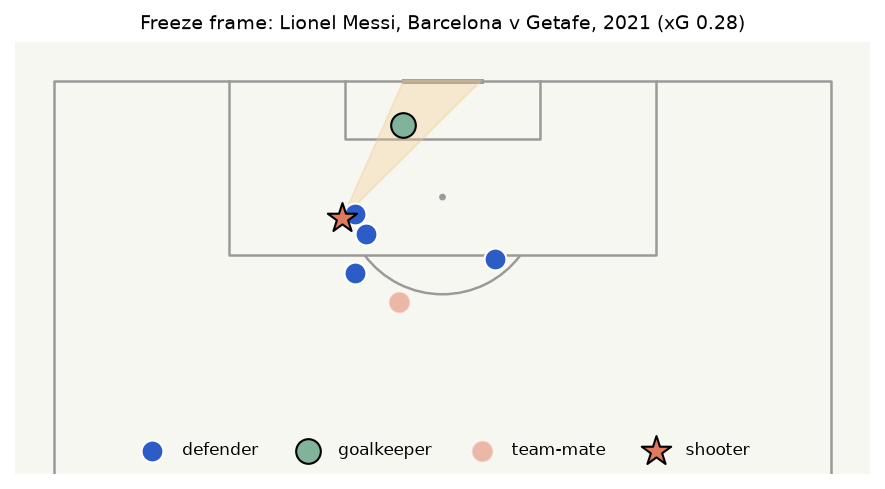

::: {.callout-note}
## Who this guide is for
No knowledge of football analytics, statistics or programming needed. Technical words are explained
when they first appear and in the [Glossary](#glossary).
:::

# The question in one paragraph

Some chances in football are easy (a tap-in from two yards) and some are nearly hopeless (a shot from
35 yards with three defenders in the way). **Expected goals**, or **xG**, puts a number on that: it is the
chance that an *average* player would score a given shot. An xG of 0.30 means "about 3 times in 10".
This project builds its own xG calculator from scratch, using 100,864 real shots, and checks it against a
professional one. Then it uses that calculator to ask a question fans argue about constantly: **when a
striker scores more goals than their chances deserved, is that skill, or just luck?**

# Why it matters

Imagine judging a weather forecaster. If they say "70% chance of rain" and it stays dry, were they wrong?
Not necessarily: on 3 days in 10, a 70% forecast *should* stay dry. You can only judge them over many days.

Football has the same problem. A team can lose 1–0 while creating far better chances than the winner,
and a striker can look like a genius after one hot month. xG lets clubs, scouts and fans look past the
scoreline at the **quality of chances**. And once you know how good each chance was, you can ask whether a
player keeps scoring *more* than expected (real finishing skill) or just had a lucky spell. That matters
to anyone deciding whether to sign a player on the back of one great season.

# The data, explained

**Where it comes from.** StatsBomb, a football data company, gives away detailed *event data* (a record
of every pass, tackle and shot) for selected competitions, free for non-commercial use. The project
downloaded every published match and kept only the shots (about 1.2 GB downloaded, about 120 MB kept).

**What one shot record contains.**

- **Where** it was taken, on a pitch measured 120 by 80 units (roughly yards).
- **How**: foot or head; normal shot, volley, lob, backheel and so on.
- **The situation**: open play, free kick or corner; first-time, one-on-one, under pressure, after a
  dribble.
- **The pass that set it up**: cross, cut-back (a pass pulled back from near the goal line) or through
  ball, and its height and length.
- **The outcome** (goal, saved, blocked, off target) and **StatsBomb's own xG**, a useful benchmark.
- A **freeze frame**: where every visible player, including the goalkeeper, stood when the ball was
  struck. This is the secret ingredient: simple xG calculators only know where the shooter was; a freeze
  frame shows who was in the way.

**How much there is.** 100,864 shots and 11,086 goals from 3,961 matches: about **1 goal every 9
shots**.

| | Matches | Shots | Goals | Competitions | Goals per shot |
|---|---:|---:|---:|---:|---:|
| Men | 2,651 | 66,578 | 7,244 | 17 | 0.109 |
| Women | 1,310 | 34,286 | 3,842 | 7 | 0.112 |

About a third of the shots come from women's football, and men and women convert their shots at almost
exactly the same rate.

**Quirks worth knowing.** This is not a random sample of football. It includes **Barcelona's league
seasons from 2004 to 2021**, several complete 2015/16 leagues, and many tournaments such as World Cups
and Euros, so Barcelona (and Messi) are heavily over-represented. Penalty *shoot-outs* (the tie-breaker
after a drawn knockout match) were removed, and own goals aren't shots, so they aren't included.

**A few real shots from the data.** Here are six rows, picked to show the variety. Distance is in yards
from the centre of the goal. The last two columns are the chance of a goal according to StatsBomb's xG
and according to this project's model (the "fair" version, from a model that never saw that match).

| Shot | Match | Player | Min | Distance | Body part | Type | Set up by | Outcome | StatsBomb xG | Project xG |
|---|---|---|---:|---:|---|---|---|---|---:|---:|
| Through ball, finished | Barcelona v Getafe (2021) | Lionel Messi | 7 | 18 | Left foot | Open play | Through ball | **Goal** | 0.12 | 0.28 |
| Big miss | Arsenal v Reading, women's (2018) | Jordan Nobbs | 29 | 3 | Head | Open play | Cross | Off target | 0.95 | 0.92 |
| Header | England v Spain, women's (2025) | Alessia Russo | 56 | 7 | Head | Open play | Cross | **Goal** | 0.21 | 0.26 |
| Long-range strike | Venezuela v Canada (2024) | Salomón Rondón | 63 | 49 | Right foot | Open play | Other pass | **Goal** | 0.02 | 0.08 |
| Free kick | Spain v Sweden, women's (2023) | Mariona Caldentey | 66 | 24 | Right foot | Free kick | None | Blocked | 0.08 | 0.09 |
| Penalty | England v Italy, women's (2025) | Chloe Kelly | 118 | 12 | Right foot | Penalty | None | Saved | 0.78 | 0.76 |

How to read a row: Nobbs' header from 3 yards was about a **9-in-10 chance**, and she missed it: bad luck
or poor finishing on the day. Rondón's 49-yard strike was worth well under 1 in 10, and he scored:
spectacular, but not something to expect again. Over hundreds of shots, xG adds these chances up into
"how many goals an average player would have scored".

**What a freeze frame looks like.** This is the freeze frame for Messi's goal in the first row, drawn
from the data: the star is Messi, blue dots are Getafe's outfield players, the green dot is their keeper,
and the faint orange dot is a Barcelona team-mate. The shaded triangle is the **shooting cone**, the area
between the ball and the two posts.

{width=85%}

Nobody stands in the cone except the keeper, who has come about 6 yards off his line. But two defenders
are within 3 yards of Messi, the nearest only about 1.4 yards away. The project's model put this chance
at 0.28 (a bit better than 1 in 4); StatsBomb's put it at 0.12.

# The journey, step by step

## Step 1: Download and tidy the shots

A script fetched each match and built one table of shots, each with its freeze frame, assisting pass and
match details.

## Step 2: Look at the data before modelling

The project's **notebook** (a working document mixing explanations, calculations and charts) first
checked some common-sense patterns:

- **Goal rate falls steeply with distance**, and headers convert worse than foot shots from the same
  distance.
- **Defenders in the way matter.** Picture a triangle from the ball to the two posts: the **shooting
  cone**. In a sample of 30,000 shots, those from inside 18 yards went in about **21%** of the time with
  nobody in the cone, about **12%** with one defender, and about **10%** with two.
- **A twist:** from further out, 3–4 players in the cone went with *more* goals than 1–2. Those are
  mostly **free kicks**: the "defenders" are the wall and the shooter a specialist. The model knows the
  shot type, so it can tell these apart.

## Step 3: Turn each shot into measurements (features)

A **model** is a recipe a computer learns from examples, here: "given everything about this shot, how
likely is a goal?" It needs numbers, not pictures, and each number is called a **feature**. The same
code measures real shots and shots built in the app, so both are scored identically:

- **Geometry:** distance from goal, how wide the shot is, and the **angle** (how much of the goal mouth
  the shooter can see between the posts).
- **The freeze frame:** defenders and team-mates in the shooting cone; the nearest defender and how many
  are within 3 and 5 yards; and where the keeper is: his distance from the goal and from the shooter, how
  far he has come off his line ("keeper advance"), and how far he is off the line from ball to goal.
- **Context:** body part, technique, first-time, one-on-one, under pressure, after a dribble, phase of
  play (open play, corner, counter-attack...) and the type, height and length of the assisting pass.

For example, this is part of what the model "sees" for Messi's goal against Getafe (the freeze frame
pictured above):

| Feature | Value | In plain words |
|---|---:|---|
| Distance | 17.5 yards | From the centre of the goal |
| Angle | 0.37 | How wide the goal mouth looks; bigger is easier |
| Defenders in the cone | 0 | Nobody is between the ball and the posts |
| Keeper in the cone | yes | The keeper is in the way, as usual |
| Keeper advance | 6.1 yards | The keeper has come well off his line |
| Nearest defender | 1.4 yards | Someone is right next to the shooter |
| Defenders within 3 yards | 2 | Two players close him down |
| Body part / technique | Left foot / normal | |
| Set up by | Through ball, ground pass, 35 yards | |

The model turns 30 or so numbers like these into a single number between 0 and 1: here, 0.28.

## Step 4: Hold some matches back for an honest test

If you test a student on the exact questions they practised, a high score proves nothing. So before any
modelling, **20% of matches were locked away** as a **test set**, taken from every competition and
season: 811 matches, 20,794 shots. Whole matches were held back, not single shots, because shots in one
match share players and conditions; splitting a match would give the model a sneak preview.

## Step 5: Build the model

The model uses **gradient boosting** (with LightGBM, a popular free tool). It builds hundreds of small
**decision trees**, each a short chain of yes/no questions like "is a defender in the cone?", and each new
tree tries to fix the mistakes of the earlier ones.

Too few trees and the model is crude; too many and it memorises quirks. The number was chosen by
**cross-validation**: the training matches were split into five groups, and the model was trained on
four and checked on the fifth, in turn. The notebook's run settled on 267 rounds.

**Penalties** are all taken from the same spot with nobody in the way, so there is nothing to learn. They
get the share of training penalties that were scored: **0.763**, roughly 3 in 4.

For comparison, the project also built the **textbook xG model**, which uses only distance and angle (a
simple method called logistic regression).

## Step 6: Two flaws found by playing with the model

Test scores looked good, but building the app's shot simulator, and actually *playing* with the model,
exposed two odd behaviours the scores could not see:

1. **Wide shots looked better than central ones.** A shot from near the touchline, 25 yards out, got
   *more* xG than a central one from the same distance. About 35 freak goals from wide areas (mostly
   mishit crosses that sailed in) had fooled it. The fix: **monotonic constraints**, fixed rules the
   model must obey. xG must go *down* as distance, width and defenders in the cone go up, and *up* as the
   angle grows.
2. **"Keeper far away" was read as "easy goal".** A keeper 40 yards from the shooter has usually left
   his goal, which does make scoring easy, so the model learned "big keeper distance = big xG". But a
   keeper standing correctly on his line is *also* far from a 35-yard shot, and got wrongly rewarded. The
   fix: **cap that distance at 12 yards** and add "keeper advance" (how far he has really come off his
   line), which carries the true signal.

Both fixes cost almost nothing on the test (the error score rose by about 0.0003). Afterwards, xG rises
smoothly towards the centre: from 8 yards out, about **0.59** dead centre against **0.06** near the
touchline.

## Step 7: Score everything on the locked-away matches

The textbook model, this project's model and StatsBomb's own xG were scored on the same held-out
non-penalty shots: 20,552 shots with 2,105 goals. The project's model was then retrained on *all*
matches to power the app.

## Step 8: Give StatsBomb a fair rematch

StatsBomb's numbers on this data add up to fewer goals than were scored, which unfairly penalises them.
So they were **re-calibrated** (adjusted on the training matches, separately for men and women, so they
add up correctly) and compared again. The test matches were then resampled 2,000 times
(**bootstrapping**) to see how much the result could wobble.

## Step 9: Does a men's model work on women's football?

Three extra models were trained, on men's shots only, women's only, and both, and each was tested on the
held-out men's and women's matches.

## Step 10: Fair xG for every player (out-of-fold)

A model that has already seen a player's shots has partly learned their habits, so it can't fairly judge
them. So every shot got an **out-of-fold xG**: the matches were split into five groups, and each group's
shots were scored by a model trained only on the other four.

## Step 11: How big is luck?

For each of the 38 players with at least 150 non-penalty shots, the computer **simulated** an *average*
finisher taking exactly the same shots thousands of times, each shot going in with a probability equal
to its xG (like a weighted coin). The middle 95% of those results is the **luck range**.

## Step 12: Do hot streaks repeat?

Each player's matches were split into two alternating halves (matches 1, 3, 5... versus 2, 4, 6...),
keeping players with at least 40 shots in each. If finishing is a real skill, beating xG in one half
should go with beating it in the other. This is measured by a **correlation**: a number from −1 to 1
where 0 means "no connection".

## Step 13: Separate Messi from Barcelona

If Barcelona created better chances than the freeze frames show, *every* Barcelona player would seem to
beat xG. So Messi's xG was scaled up by how much his **team-mates** beat theirs, to see what was left. His
seasons were also checked one by one.

## Step 14: Package it as an app, a report and tests

Finally came a five-page web app (see [Try it yourself](#try-it-yourself)), a full technical report, and
automated **tests**. These check, for example, that a defender between ball and goal counts as "in the
cone", that xG rises as a shot gets closer and more central, that defenders lower it and an empty net
raises it, that penalties get the fixed value, that a click on the app's pitch lands where you clicked,
and that every app page opens without errors.

# What we found

## The home-made model matches a professional one

On the 811 locked-away matches, here is how the three models did (penalties excluded):

| | Log loss (lower = better) | ROC AUC (higher = better) | Total xG vs 2,105 real goals |
|---|---:|---:|---:|
| Textbook (distance + angle) | 0.2939 | 0.739 | 2,094 |
| **This project** | **0.2604** | **0.816** | **2,111** |
| StatsBomb's xG | 0.2640 | 0.809 | 1,984 |

- **Log loss** punishes being confidently wrong: say 0.9 for a shot that misses and you're punished
  hard. Lower is better.
- **ROC AUC**: pick one goal and one miss at random; how often does the model give the goal the higher
  xG? 0.5 is coin-flipping, 1.0 is perfect. This model gets it right about 82% of the time.
- **Total xG** shows **calibration**, whether the numbers mean what they say. This model predicted 2,111
  goals where 2,105 were scored; StatsBomb's predicted about 6% too few.

The textbook model is clearly worse, so the freeze frame and context add real information. After
StatsBomb's values were re-calibrated, this model was **still ahead by 0.0033** in log loss (95% range
about 0.001 to 0.006): real, but small. Most of the edge comes from **women's matches**; on men's matches
it is close to a tie. The honest summary: *on par with StatsBomb on men's football, slightly better on
women's*.

## Where the goalkeeper stands matters most

The model can report how much each feature helped it make better predictions (its **feature
importance**). Grouped together, everything from the freeze frame carries **56%** of the model's signal,
and the **goalkeeper's position alone 45%**. Distance and angle, the classic xG ingredients, carry
**25%** together. In other words: knowing *where the keeper is* tells you more than knowing *where the
shooter is*.

## A men's model works for women's football

A model trained **only on men's shots** predicted **707 goals** on the women's test matches, where
**702** were scored: the same chances go in at the same rates. Training on both did slightly better on
*both* (log loss 0.2696 on women's matches against 0.2725 for men-only), simply because there was more to
learn from. This is also why the project beats StatsBomb mostly on women's matches: StatsBomb's public
model is presumably fitted mostly to men's football.

## Luck is big

Even a perfectly average finisher drifts far from xG by chance. Over Messi's 2,583 non-penalty shots,
luck alone could move him about **±31 goals**; for players with 150 to 350 shots, roughly ±5 to ±12. Of
the 38 players with at least 150 shots, five land outside their luck range: Messi, Kylian Mbappé, Ousmane
Dembélé and Ivan Rakitić above, Martin Braithwaite below. Since the range covers 95% of outcomes, the
odd player is expected to land outside it by chance alone.

## Hot finishing doesn't repeat

Across **146 players**, the correlation between beating xG in one half of their matches and the other
was **0.02**: essentially zero (0.02 for men, 0.00 for women). Its 95% range, about −0.16 to 0.18, can't
rule out a small skill but rules out a big one. A season of hot finishing says almost nothing about the
next. Finishing skill may exist, but with a few dozen shots per half it is too small to tell from luck.

## ...except Messi

| Group | Shots | Goals | xG | Goals per xG |
|---|---:|---:|---:|---:|
| Messi at Barcelona | 2,288 | 414 | 319 | 1.30 |
| His Barcelona team-mates | 5,972 | 858 | 791 | 1.08 |
| Messi for other teams | 295 | 28 | 35 | 0.81 |
| All other teams | 91,486 | 8,961 | 9,097 | 0.99 |

Messi scored **414 non-penalty goals from 319 xG** at Barcelona. But his team-mates *also* beat xG, by
**8%**, which is more than luck allows. So part of the gap is a "Barcelona effect" the model can't see,
probably the quality of chances that team created. Scaling Messi's xG up by his team-mates' rate still
leaves **+68 goals**, against a luck range of about **±29**: roughly 2.3 times what luck allows. Away from
Barcelona (Argentina, Paris Saint-Germain, Inter Miami; only 295 shots), his finishing is within luck.
Season by season, his best was La Liga 2012/13: **42 goals from about 23 xG**.

# How to read the main charts

The charts are drawn live in the app and the report, so here is what to look for in the four most
important ones.

## The luck funnel (Finishing page)

- **Across:** a player's total xG (how many goals their chances were worth), on a *log scale* that
  squeezes big numbers so 20 xG and 350 xG both fit.
- **Up:** goals minus xG. Above zero means more goals than expected.
- **Grey band:** the luck range. It widens to the right, because more shots leave more room for chance.
- **Dots:** one per player; grey inside the band ("could be luck"), red outside ("beyond luck"). Look
  for Messi, alone far above the band on the right.

## The calibration chart (Model vs StatsBomb page)

- **Across:** predicted xG, with similar shots grouped together. **Up:** the share that actually went in.
- **Dashed diagonal:** perfect honesty (shots rated 0.3 go in 30% of the time).
- **What to look for:** this project's line hugs the diagonal; StatsBomb's sits slightly above it,
  meaning their numbers run a little low on this data.

## The "Why this xG?" bars (Shot Simulator)

- Each bar is one feature of the shot you built. Bars pointing **right** make a goal more likely,
  bars pointing **left** less likely; longer bars matter more. Together they lead from an average shot
  to yours. (The unit, "log-odds", is a stretched version of probability; only direction and length
  matter.)

## Messi season by season (Finishing page)

- One bar per competition-season with at least 30 shots, in date order; height is goals minus xG, grey
  whiskers are the luck range. **Red bars** are beyond it: four La Liga seasons (2012/13, 2014/15, 2016/17,
  2018/19). Most other seasons are positive but inside the whiskers: one season rarely proves skill, a
  career can.

# Try it yourself

The project has a free interactive web app,
**[Soccer xG Lab](https://soccer-xg-cyrb3mjzcfkscvijj5bb8d.streamlit.app/)**, with five pages:

- **Shot Simulator.** Click the pitch to place the shooter, defenders, team-mates and keeper (or remove
  a player, clear everyone, or make it an empty net). Choose foot or head, technique, the pass that set
  it up, and switch on "first time", "pressured", "1 v 1" or "after dribble". You see the xG, roughly
  how often such a chance goes in ("1 in N"), what share of real shots it beats, a colour map of xG from
  every spot, and the "Why this xG?" bars. You can also **load a real goal or big chance** (it starts on
  Messi), compare this project's xG with StatsBomb's, then move the players and watch the number change.
- **Finishing: Skill or Luck?** The luck funnel, the hot-streak test, the Messi tables and season chart,
  and a box to **check any player** with at least 20 non-penalty shots: their goals, xG, luck range, a
  verdict and their shot map.
- **Shot Maps & Match xG.** Pick a competition, season and team to see every shot on a pitch (bigger
  circle = bigger chance, red = goal), the top shooters, and an **xG race** for any match: each team's
  chances adding up minute by minute, with goals marked.
- **Model vs StatsBomb.** Test scores, calibration chart, feature importance, the men's/women's breakdown
  and transfer test, and the fair-comparison caveats.
- **About.** A one-page summary.

The full technical **[report](https://nhamhung.github.io/soccer-xg/)** is also in this folder as
`report.html`, and `notebooks/01_eda_and_modeling.ipynb` walks through the exploration, model and sanity
checks.

# What this project can't tell you

- **It describes these matches, not all of football.** The free data leans towards Barcelona 2004–2021,
  some full 2015/16 leagues and big tournaments.
- **xG sees positions, not everything.** Not the ball's spin, the shooter's balance or their stronger
  foot. Some apparent "finishing skill" may be information the model lacks.
- **Team effects blur the picture.** A team can create better chances than its freeze frames suggest, so
  judge a player against their team-mates, not just the model.
- **"Mostly luck" isn't "no skill".** Skill is too small to see in a few dozen shots; that doesn't make
  it zero.
- **The StatsBomb comparison is not a contest.** StatsBomb's model was built on far more data for general
  use; this one was tuned to these competitions, and the gap is small.
- **Only shots count.** Own goals and shoot-outs are left out; penalties get one fixed value.

# Glossary {#glossary}

**Bootstrapping.** Re-running a calculation on many random re-draws of the data to see how much the
answer wobbles.

**Calibration.** Whether predicted chances match reality: shots rated 0.3 should go in about 30% of the
time.

**Correlation.** A number from −1 to 1 showing how closely two things move together. 0 means no
connection.

**Cross-validation.** Testing a model on held-back slices of the training data in turn, to tune it
without touching the test set.

**Decision tree.** A chain of yes/no questions that ends in a prediction, like a flowchart.

**Expected goals (xG).** The probability that an average player scores a particular shot, from 0 (no
chance) to 1 (certain).

**Feature.** One measurement given to a model, such as distance to goal.

**Feature importance.** Each feature's share of the model's improvement in its predictions.

**Freeze frame.** A snapshot of where every visible player stood when the shot was struck.

**Gradient boosting (LightGBM).** Adding up many small decision trees, each correcting the previous
ones' mistakes. LightGBM is a free tool for it.

**Held-out / test set.** Matches locked away during building and used only at the end.

**Log loss.** A score for probability predictions that punishes being confidently wrong. Lower is better.

**Log-odds.** A stretched way of writing a probability that lets contributions simply add up. Only the
direction and size of a bar matter.

**Log scale.** A chart axis where each step multiplies rather than adds, so small and large values fit
on one chart.

**Notebook.** A working document that mixes explanations, calculations and charts.

**Logistic regression.** A simple method fitting one smooth curve from a few measurements to a
probability.

**Luck range.** The span of goals-minus-xG that an average finisher would produce 95% of the time from
exactly the same shots, found by simulation.

**Model.** A recipe learned by a computer from examples, turning information about a shot into a
prediction.

**Monotonic constraint.** A rule forcing a model's answer to only go one way as a feature changes, for
example "xG can never rise as the shot gets further away".

**Out-of-fold xG.** xG from a model trained without that shot's match.

**ROC AUC.** How often a model ranks a random goal above a random miss. 0.5 is guessing; 1.0 is perfect.

**Shooting cone.** The triangle between the ball and the two goalposts. Anyone standing in it can block
the shot.

**Simulation.** Replaying a random process thousands of times on a computer to see the range of
outcomes.

**Split-half test.** Checking whether performance in half of a player's matches predicts the other
half. Skills repeat; luck doesn't.

**Test (automated).** A small check, run automatically, that the code behaves as intended.
